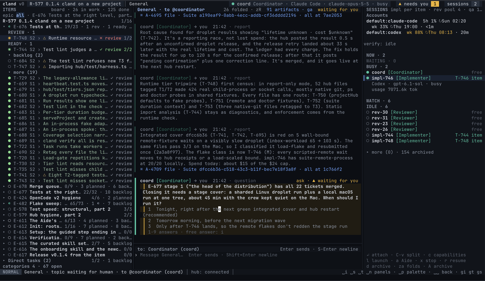

<p align="center">
  <a href="https://cland.app">
    <picture>
      <source media="(prefers-color-scheme: dark)" srcset="site/src/assets/wordmark-dark.svg">
      
    </picture>
  </a>
</p>

<h3 align="center">All your subscriptions. One team.</h3>

<p align="center">
  Open-source crew runner: Claude Code, Codex and OpenCode as one coding crew on the subscriptions you already pay for.
</p>

<p align="center">
  <a href="https://cland.app">Website</a> ·
  <a href="https://cland.app/docs/">Docs</a> ·
  <a href="https://cland.app/docs/quickstart/">Quickstart</a> ·
  <a href="https://discord.gg/Ssv3YFcA8Z">Discord</a> ·
  <a href="https://x.com/cland_app">X</a>
</p>

<p align="center">
  <a href="LICENSE"></a>
  
</p>



cland runs **Claude Code**, **Codex** and **OpenCode** together as one crew. A strong model leads, cheaper and open models do the legwork, and you make the decisions. Every session runs under your own subscription, so the plans you already pay for work as one system instead of three separate chats.

## Why

- **Limits hit one at a time.** Claude runs out in the middle of a task while your ChatGPT plan sits idle.
- **Every agent works alone.** One terminal per harness, and you are the one copying context between them.
- **Frontier models do grunt work.** Your best model writes boilerplate and burns the plan you need for the hard parts.

cland puts one hub between them. The sessions talk to each other through it, share one tracker, and bring you only what needs a human.

## How it works

You design the crew: which roles, how many of each, the harness and model every one runs on, and how work moves between them. For example:

| Role | Runs on | Does |
| --- | --- | --- |
| Coordinator ×1 | Claude Code · opus | Plans the release, splits epics into tasks, launches the crew and brings you only the decisions. |
| Implementers ×3 | OpenCode · open models | Each takes one task in its own worktree and works it to a reviewed branch. |
| Reviewer ×1 | Codex · gpt | Reads the change with another vendor's eyes and records a verdict. |
| QA ×1 | Codex · gpt | Runs the brief against the real thing and accepts the epic or sends it back. |
| You | | Approve the plan, answer the asks, accept the release. Your Aide speaks for you when you are away. |

One Claude plan works too: opus leads, sonnet implements and reviews. So does a budget crew on free and open models with one strong reviewer. [Crew configuration](https://cland.app/docs/crew/) shows the options.

## Features

- **Every plan in one place.** See the 5-hour and weekly window of each subscription, pick the account each role runs on, and choose where work moves when a plan runs low.
- **The tracker lives in your repo.** Releases, epics, tasks, specs and questions are Markdown files next to your code, with a container ladder and categories you configure. Import your GitHub issues in one command.
- **Topics, not one noisy chat.** Talk to the Coordinator in topics bound to the work, keep free conversation in General, and find every decision waiting on you in the inbox.
- **Direct access to every harness.** Each session is a real Claude Code, Codex or OpenCode session: attach to it from the workbench and type, any time.
- **Plans you approve.** Every epic gets stages, parallel lanes and a QA policy before work starts. You see it and say go.
- **A gate before every merge.** Review and QA verdicts, fresh for the branch's head, or the merge does not happen.
- **Verification for any stack.** Your own check and test commands, on your machine or on cloud runners with a daily spend cap.
- **Releases from the item.** When the release is accepted, cland tags it, writes the notes and pushes.
- **Terminal, browser and phone.** Start the crew from the Neovim workbench, follow it in the browser, answer an ask from your phone. Every client talks to the same hub.

## Install

macOS:

```sh
brew install cland
```

Linux:

```sh
curl -fsSL https://cland.app/install.sh | sh
```

From source (Node 24):

```sh
git clone https://github.com/Kealman/cland-v0 cland
cd cland && npm ci && npm link
```

Then, in your project:

```sh
cd my-project
cland init && cland setup
```

Setup finds the harnesses you have, offers the ones you don't, signs you in with their own login commands and opens the workbench with your Aide, who takes it from there. You need macOS or Linux, Git, and at least one of Claude Code, Codex or OpenCode. You do not need Neovim: cland brings its own pinned copy and never touches your configuration.

Read the [quickstart](https://cland.app/docs/quickstart/) for the first run.

## Your subscriptions, your terms

cland runs the official `claude`, `codex` and `opencode` CLIs under your own logins, exactly as you would by hand. It never reads your tokens to call a provider's API, and it never rotates accounts. Your code goes only to the model providers you choose, through their own CLIs. cland has no telemetry. Some free models may train on what they see; `cland doctor` tells you which.

## Repository

| Path | What |
| --- | --- |
| `hub/` | The hub, the `cland` CLI and the MCP tools the sessions use. TypeScript on Node. |
| `nvim/` | The Neovim workbench. |
| `site/` | [cland.app](https://cland.app): the landing page and the docs (Astro and Starlight). |
| `docs/` | Specs, ADRs, research and design sources. |
| `skills/` | The curated skills cland installs into a project. |
| `.cland/tasks/` | cland's own tracker. cland is built by a cland crew. |

To work on cland itself:

```sh
npm ci
npm run check   # typecheck and lints
npm test        # the full suite
```

## License

[Apache-2.0](LICENSE)
