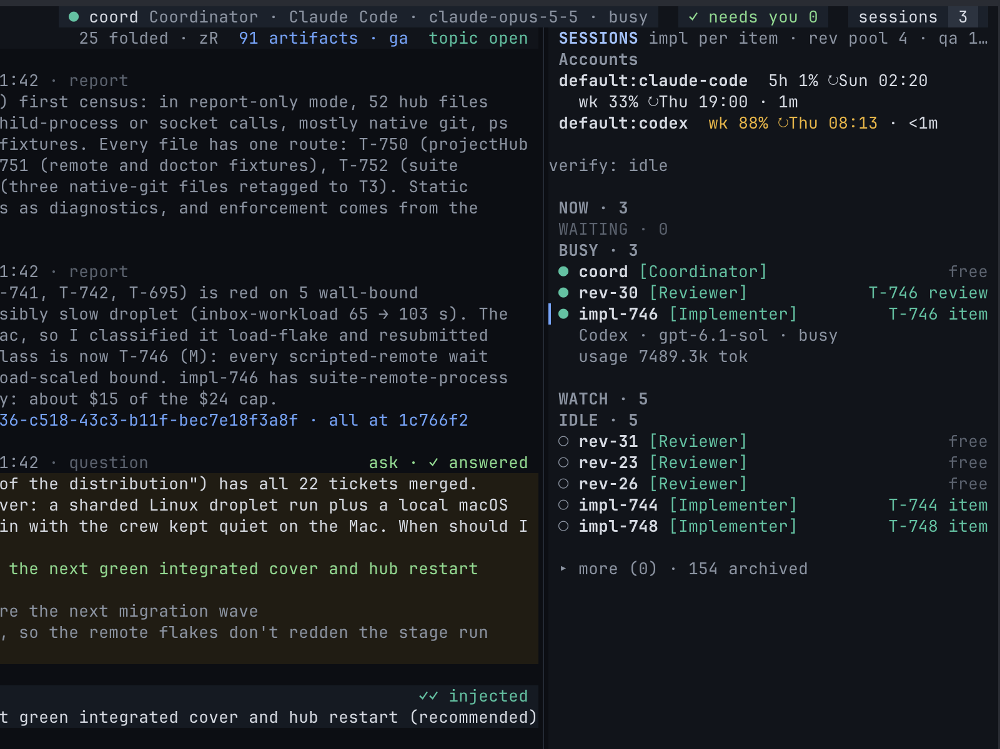

Every session runs under one of your own harness logins. cland reads usage limits through the harness, shows them as meters, and refuses new launches on an account that hit its limit. It never moves your work to another account by itself.

## How cland uses your plans

Be clear on what cland does and does not do:

- **It runs the official CLIs.** Every session is the real `claude`, `codex` or `opencode` program, signed in with the harness's own login command, running under your account as if you had started it yourself.
- **It never reads your tokens.** cland does not open credential files or keychains, does not call any provider's API with your credentials, and does not call usage endpoints. Limits are read from the running harness, or by asking the harness itself.
- **It never rotates or switches accounts on its own.** No failover, no round-robin, no moving a running session. The providers' terms forbid rotating accounts or using several accounts to get past limits. Which account a role uses is always your decision.
- **It stores no secrets.** The account registry holds names and paths only.

:::caution
OpenCode's free models may use the code they see for training. `cland doctor` warns for every role configured on OpenCode, and also notes that OpenCode runs commands without an OS sandbox. Use a paid provider, or keep OpenCode roles off code you cannot share.
:::

## Registering accounts

With one login per harness you need no registry: sessions use the harness's default login.

Register accounts when you have more than one login for a harness, or want named meters per account. `cland setup` offers to do it: it lists the profiles you are signed in to and writes their names and paths. You can also edit the file yourself.

The registry is user-level, shared by all your projects: `~/.config/cland/accounts.toml` (or `$XDG_CONFIG_HOME/cland/accounts.toml`).

```toml
# A second Claude login, in its own config directory.
[accounts.claude-work]
harness = "claude-code"
config_dir = "~/.claude-work"        # CLAUDE_CONFIG_DIR

# A second Codex login.
[accounts.codex-b]
harness = "codex"
home = "~/.codex-b"                  # CODEX_HOME

# An OpenCode login in its own data directory.
[accounts.oc-router]
harness = "opencode"
data_home = "~/.local/share/oc-router"   # XDG_DATA_HOME
# or: db = "/absolute/path/opencode.db"  (OPENCODE_DB), never both
```

- Names use lowercase letters, digits and hyphens.
- Each entry has a `harness` and at most one path key that belongs to it.
- An entry without a path names the harness's default login. At most one such entry per harness.
- Unknown keys are refused, `token` and `api_key` included.

Sign in to each directory once with the harness's own command. When a directory is missing, cland refuses the launch and prints the exact line, for example:

```sh
CLAUDE_CONFIG_DIR=~/.claude-work claude auth login
CODEX_HOME=~/.codex-b codex login
```

Every process cland starts for a session runs in that account's environment: the session itself, its attach command, its relaunches and the harness's limit checks.

## Listing accounts

```sh
cland account list
```

```text
claude-work  claude-code  ~/.claude-work  5h 42% ↻14:00 · wk 18% ↻Sun 04:03 · 2m ago (session impl-42)
codex-b      codex        ~/.codex-b      5h 7% ↻16:20 · wk 61% ↻Thu 09:12 · 9m ago (session rev-1)
oc-router    opencode     ~/.local/share/oc-router   no limit data
```

`--refresh` asks idle accounts for a new reading. `--json` prints the raw list. Any session may run this command.

## Choosing an account

### Per role

Pin a role to an account in `.cland/roles.toml`:

```toml
[implementer.launch]
harness = "codex"
account = "codex-b"
```

Or with a command:

```sh
cland role launch implementer --harness codex --account codex-b
```

`account` is one name, never a list. Empty or absent means the harness's default login. The change applies to the next launch, without a restart.

### Per launch

```sh
cland session launch impl-43 --role implementer --item T-43 --account codex-b
```

`--account` overrides the role's account for this launch and picks the account's harness, unless you give a conflicting `--harness`, which is refused.

A running session stays on its account for its whole life, through relaunches and pool reuse. To move a role to another account, change the pin; new sessions take it.

## The meters



The sessions panel opens with an **Accounts** block, and the web workbench has an **Accounts** area. Each account shows the windows its harness reports:

- the **5-hour** window (`5h`);
- the **weekly** window (`wk`);
- per-model weekly windows when the harness reports them.

Each window shows the used share and its reset time (`↻14:00` today, `↻Sun 04:03` this week), followed by the age of the reading.

| Colour | Meaning |
| --- | --- |
| Normal | Under 75% used. |
| Amber | 75% or more, or the harness reports a warning. |
| Red | 90% or more, or the harness reports it critical. |
| Dimmed | The reading is older than 30 minutes. |
| Red `✗ limited` | The account hit its limit. New launches on it are refused. |

Where the readings come from:

- **Claude Code** reports its windows through the session's status line while a session runs.
- **Codex** reports rate limits through its app server while a session runs.
- **Idle accounts** are checked through the harness itself (`claude -p "/usage"`, a short-lived Codex app server), at most every 15 minutes, with longer back-off after failures.
- **OpenCode** reports no limits. It shows `no limit data`.

An account with no reading yet says `no reading yet`; a signed-out one says `signed out` with the login command.

## When an account hits its limit

When a harness signals a hard limit (not a passing rate throttle), the hub:

1. Marks the account **limited** until its reset, or "until cleared" when the reset is unknown.
2. Posts one warning to the inbox, the Agents topic and the Coordinator.
3. Refuses every new launch, relaunch and pool reuse on that account, with the account and reset time. Running sessions keep running.

The Coordinator then reads `cland account list` and asks you. The ask names the limited account and its reset, lists the harness's other accounts with their current usage, and offers:

1. Launch this one session on another account.
2. Pin the role to another account from now on.
3. Wait for the reset.

You choose. cland applies exactly that choice and nothing else.

A limited mark lifts by itself at the reset time. To lift it earlier, for example after you upgraded the plan:

```sh
cland account clear claude-work
```

OpenCode never reports a reset, so its mark stays until you, or the Coordinator on your word, clear it.

## Plans and terms

cland is a way to run the CLIs you already use, under the plans you already pay for. Each harness runs under its own provider's terms and limits:

- Use each account the way its plan allows. cland's job is to show you the limits and to stop launching on a limited account, not to work around them.
- A second paid account for overflow is your own call, made per provider's terms. cland never picks it for you.

See also the [FAQ](/docs/faq/) on subscription terms.
