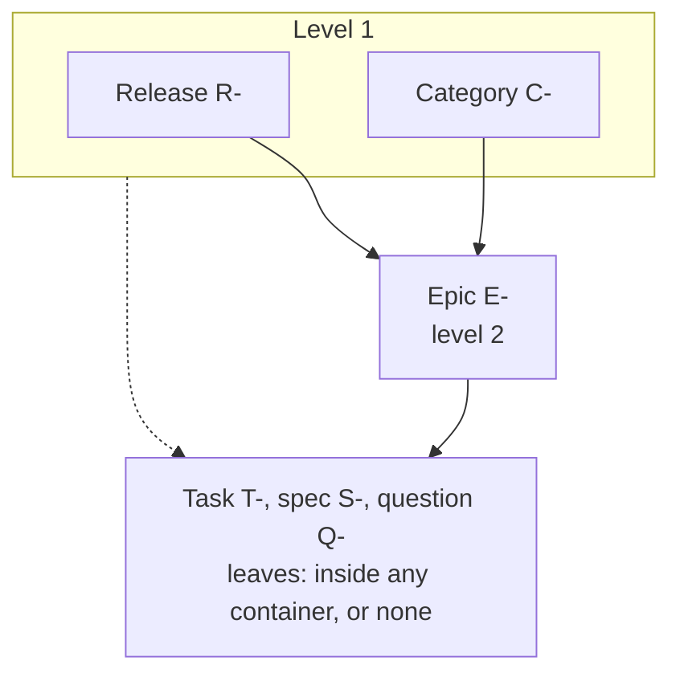
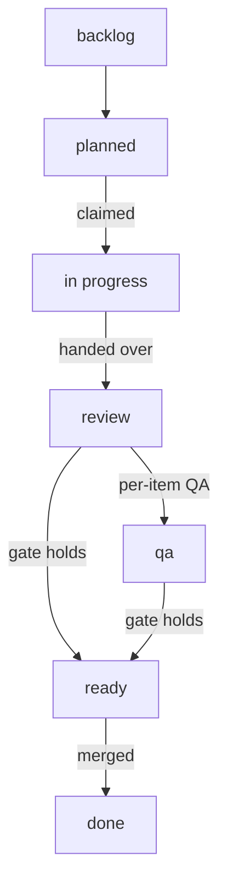

import Screenshot from '../../../components/Screenshot.astro';

The crew's work lives in a tracker inside your repository. Every **item** is one Markdown file under `.cland/tasks/`, committed with the code it describes. The plan, the history and the review trail travel with the branch. There is no tracker service to sign in to.

The tracker is the crew's only source of work. The Coordinator files and plans items, Implementers claim them, Reviewers and QA record verdicts on them, and you see all of it in the explorer.

<Screenshot n={5} />

## An item is a Markdown file

Each file is named `<id>-<slug>.md`. The frontmatter holds the facts the hub indexes; the body holds the text the agents read and write. A task, trimmed:

```markdown
---
id: T-42
kind: task
title: Parse the config file
state: open
status: in progress
size: S
labels: []
assignee: impl-42
parent: E-3
blocked_by: []
criterion_seq: 2
---

## Summary

Read `.cland/config.toml` at start and refuse a file that does not parse.

## Acceptance criteria

- [x] C1. A broken file is refused with the line that failed
  - done: impl-42 · 2026-10-09T10:00:00.000Z
- [ ] C2. The last good settings stay in force after a refusal
```

- **The number is the identity.** The prefix follows the kind, and all kinds share one counter: `T-17`, `E-17` and `17` find the same item.
- **Every item** has a title, a state (open or closed), labels, an assignee, a parent and blocking edges. A task also has a status, a rank, a size and acceptance criteria.
- **A `## Summary`** of one to three sentences says what the item is about. The explorer's card shows it first.
- **Change items through cland**, not by editing files: tell the Coordinator, or use `cland task`. The hub writes the files through one queue, keeps an index of them and announces every change to the sessions that follow it.

## Kinds

| Kind | Prefix | What it is |
| --- | --- | --- |
| Release | `R-` | A versioned set of epics shipped together. Has a `version`. |
| Category | `C-` | A container for work that belongs to no release or epic: Bugs, Tech debt, Follow-ups, Ideas and any you add. |
| Epic | `E-` | A larger feature, broken into tasks, with a [plan](/docs/concepts/#plans-and-approval). |
| Task | `T-` | One unit of work for one Implementer. |
| Spec | `S-` | A specification. |
| Question | `Q-` | A decision or research question. |
| Map | `M-` | A set of open questions charted before a plan exists. |

Releases, categories and epics are **containers**. Tasks, specs and questions are **leaves**. A map stands apart: it has no parent and holds questions and tasks.

## The container ladder

Which container goes inside which is a setting, `[tracker] levels` in `.cland/config.toml`. `cland init` writes the default:

```toml
[tracker]
levels = [["release", "category"], "epic"]
```



The rules:

- **Each level is one kind, or a list of peers.** A kind takes as its parent any kind of the level just above it. The first level has no parent.
- **Leaves take any container, or none.** A task can sit in an epic, directly in a release or in a category. An item with no parent at all is **unscheduled**.
- **The first kind of the first level owns releases.** Only it carries a version, and the open one with the lowest version is the current release, the one the crew works. Other root kinds, such as categories, have no version or rank.
- **A configured container's prefix is its first letter.** Kind names must be unique, must not be a leaf kind or `map`, and need distinct first letters.
- **A ladder of plain strings still works.** `levels = ["release", "epic"]` is the older form, without categories.

The hub reads the ladder when it starts. After a change, restart it:

```sh
cland hub stop && cland hub start
```

`cland update` upgrades only the old default ladder and keeps a ladder you changed.

Containers have no status of their own: their glyph, progress and layer come from their children. A container closes only when its children are closed, and an epic also needs a clear QA verdict on `dev`.

## Categories

Categories hold work that belongs to no release or epic yet. `cland init` creates four:

| Category | What goes in |
| --- | --- |
| **Bugs** | A bug found aside from the item being worked or tested. |
| **Tech debt** | Tech debt found during work. |
| **Follow-ups** | Further work on merged work, naming the merged item. |
| **Ideas** | An idea or feature proposal outside the current release or epic. |

Add your own:

```sh
cland task create "Docs" --kind category
```

- **Only the Coordinator and an Aide file items into categories.** A Lead, an Implementer, a Reviewer or QA that finds something reports it to its lead with the category and the evidence, and the Coordinator files it. Finds stop disappearing into a transcript.
- **Promotion is a message.** Ask the Coordinator to move an item into a release or an epic, rank it to the top, or plan it.
- **Idle work.** Name categories in `idle_from` in `.cland/crew.toml`, and the Coordinator takes their tasks in rank order when the current release has nothing unblocked. Empty, the default, means never:

  ```sh
  cland crew set idle_from C-2
  ```

An item in a category is not unscheduled: unscheduled means no parent at all.

## Tasks

### Status

A task's **status** says where it is in its workflow. The hub moves it on claims, verdicts and merges, so it is always the current fact, not someone's note.



A not-clear verdict or a failed criterion sends the task from `review` or `qa` back to `in progress`.

| Status | Set when |
| --- | --- |
| `backlog` | The task is filed. The default. |
| `planned` | Its epic's plan reaches the task's stage, or the Coordinator or you set it. |
| `in progress` | An Implementer claims it, or a verdict comes back not clear. |
| `review` | The Implementer hands it over for review. |
| `qa` | QA takes it, when the plan asks for QA on each task. |
| `ready` | The [merge gate](/docs/verification-and-release/#the-merge-gate) holds: current clear verdicts, every criterion done and verified. |
| `done` | It merged, or was closed. |

The Coordinator, an Aide and you may set any status: `cland task edit T-42 --status planned`.

### Rank

A task's **rank** is its place among its siblings. The lowest rank is next: the Coordinator takes the lowest-ranked unblocked planned task of the current release. Moving an item to the top is how you make it a priority.

```sh
cland task rank T-42 --top
cland task rank T-42 --before T-40
```

In the items panel, `K`, `J` and `T` do the same. Or tell the Coordinator "take T-42 next".

### Size

Every new task needs a **size**, set by whoever files it: `XS`, `S`, `M` or `L`. Larger work is refused: split it. When planning, an `L` task is split into two or three `M` tasks, or the Coordinator records in the plan why it stays whole.

### Acceptance criteria

A task's `## Acceptance criteria` are what "done" means, one line each. Every criterion gets a stable id, `C1`, `C2`, that is never reused, and carries **marks**:

| Mark | Who sets it | Meaning |
| --- | --- | --- |
| **done** | The claiming Implementer, the Coordinator, an Aide or you | The work for this criterion is in. |
| **verified** | A Reviewer or QA, with the run it came from | Checked, at a named commit. |
| **failed** | A Reviewer or QA, with a note | Not met. The task returns to `in progress`. |

A verified mark records the commit it checked and counts only at that exact head. A new commit makes it stale until a Reviewer or QA verifies it again. Every criterion must be done and verified, at the current head, before the task can merge.

```sh
cland task criterion T-42 done C1
cland task criterion T-42 verify C1 --run rev-0117
cland task criterion T-42 fail C2 --note "The old settings are lost after a refusal"
cland task criterion T-42 add "The refusal names the file"
```

A verdict can mark criteria in the same write: a clear review with `--verified C1,C3` or `--verified all`, a not-clear one with `--failed "C2=reason"`.

<Screenshot n={9} />

### Edges and history

- **Blocking edges.** `--blocked-by T-40` makes a task wait until T-40 closes. The graph view (`␣G`) draws them.
- **Regressions.** A task that reworks landed work names it with `--regression-of T-30`.
- **After a merge** a task is complete and stays closed. Further work is a new item, usually in Follow-ups, that names the merged one.

## The explorer and the card

The **explorer** is the workbench's default centre view (`␣e`): the current release as an outline of its epics and their tasks, with folded roots for the categories, the unscheduled items and the other releases. Inside a container the live items come in rank order; an epic with a plan groups its tasks by stage.

The **card** on the right follows the cursor:

- the summary;
- the facts: status, rank, layer, labels, size, the parent path, the lead, the claim and holds;
- the progress: the children's breakdown for a container, the criteria with their marks for a task;
- the plan stage of an epic;
- the latest verdict with its one-line reason;
- blocked by, blocks and the regression link;
- for a task, the branch and the latest `cland verify` result.

The agents' full text sits folded behind `zb`.

The explorer changes nothing by hand, on purpose. To re-parent, reorder, plan or promote, select the items and press `m`: the Coordinator receives your words plus one line per item and acts through the tracker. `M` sends to the item's own topic instead, creating it if needed. See [The explorer](/docs/workbench/#the-explorer) for every key.

The same items have more views: the items panel (`␣i`) as a vertical board of the current release, the board (`␣b`), the task graph (`␣G`) and an epic's plan (`gp`). In the [web workbench](/docs/web-and-phone/), the **Items** area has the tree, Board, Graph and Plan, with the card in the drawer.

## From the shell

You rarely need to: tell the Coordinator what you want and it files the items. When you do:

```sh
cland task list --under R-1                   # everything in a release
cland task view T-42                          # one item: body, criteria, plan, verdicts, claim
cland task create "Parse the config file" --size S --parent E-3
cland task link T-43 --blocked-by T-42
cland task comment T-42 "Use the TOML parser we already ship"
```

Every `cland task` command takes `--json`. The [CLI reference](/docs/cli/#tasks-and-the-tracker) lists them all.

## Importing GitHub issues

```sh
cland task import-github                 # open issues, through gh
cland task import-github --all           # closed ones too
cland task import-github --repo owner/name
```

The import reads issues through `gh` with your own login, maps labels, parents and blocking relations, and keeps the comments. Each imported item records its issue in its frontmatter. Pull requests stay on GitHub. Running it again updates the imported items in place. During the onboarding, the Aide offers the import on an existing project.

:::caution
There is no two-way sync. A re-run rewrites state, labels and edges from GitHub, so once the crew works the items in cland, stop importing: a refresh could close or reopen items to match the issues.
:::
