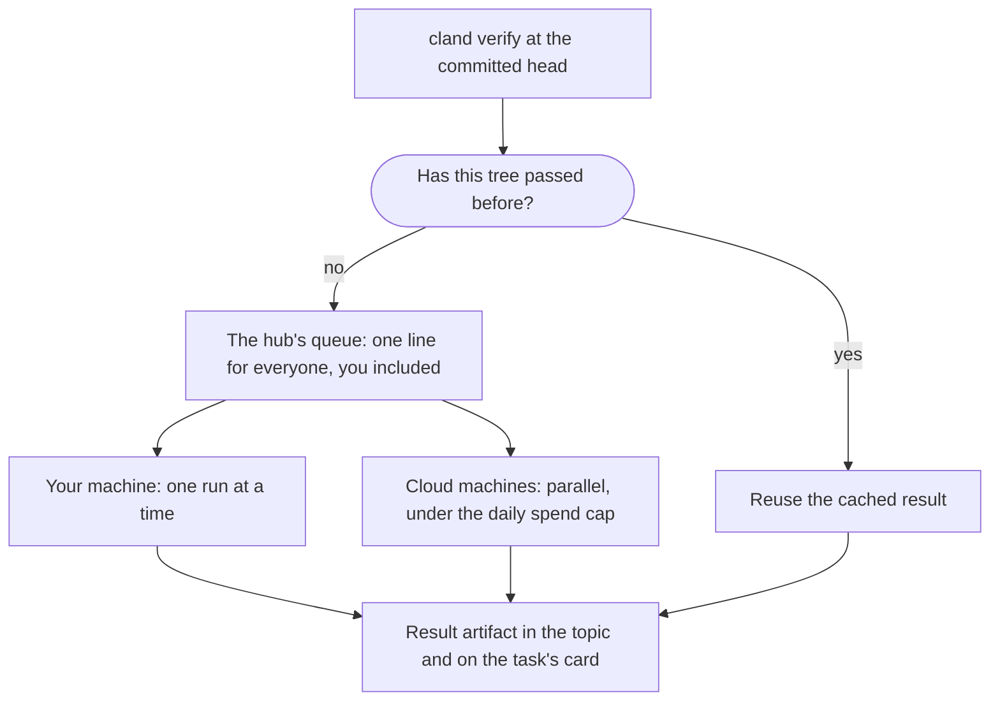
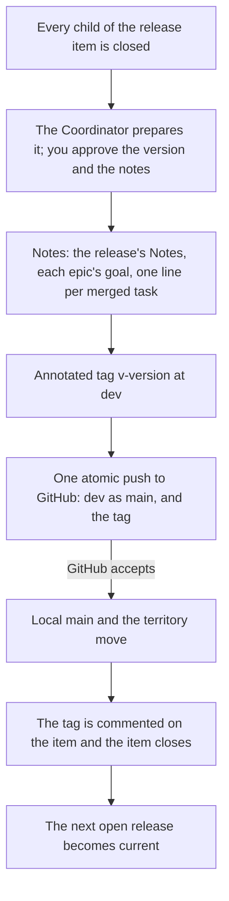

import Screenshot from '../../../components/Screenshot.astro';

Work reaches GitHub in three steps. A task is verified and reviewed on its branch, merged onto `dev` through the merge gate, and released from `dev` to GitHub `main` with a tag.

```mermaid
flowchart TB
  %% From a task branch to GitHub: review, verification and QA when the plan requires it, the merge gate, dev in the territory, then cland release to GitHub main with a tag.
  branch["Task branch<br/>in its own worktree"]
  checks["Review, cland verify<br/>and QA when the plan asks"]
  gate["Merge gate"]
  dev["dev<br/>in the territory"]
  rel["cland release"]
  gh["GitHub main<br/>tagged vX.Y.Z"]
  branch --> checks -->|clear, criteria verified| gate -->|ready| dev --> rel --> gh
  classDef out stroke:var(--cland-diagram-accent)
  class gh out
```

A not-clear verdict sends the work back to its branch: a fix makes a new head, and the new head needs a new review and a new run.

## Verification for any stack

Tell cland how to check your project in `.cland/config.toml`:

```toml
[verification]
prepare = "npm ci"            # install dependencies
check = "npm run typecheck"   # fast static checks
test = "npm test"             # the test suite
```

Any commands work. Some starting points:

| Stack | `prepare` | `check` | `test` |
| --- | --- | --- | --- |
| Node | `npm ci` | `npm run typecheck` | `npm test` |
| Python | `uv sync` | `ruff check .` | `pytest -q` |
| Go | `go mod download` | `go vet ./...` | `go test ./...` |
| Rust | `cargo fetch` | `cargo clippy -- -D warnings` | `cargo test` |

The onboarding Aide records them with your stack. To change one:

```sh
cland config set verification.test "pytest -q"
```

## Running a verification

```sh
cland verify --report general
```

`cland verify` runs `check`, then `test`, at the current committed head, in the background. `--report` names the topic or session that receives the result: General here, usually the task's own topic. The result is an artifact with the log, posted there and shown on the task's card.

The hub owns the queue:

- One local run at a time, so the crew never overloads your machine. Everyone waits in the same queue, your own runs included.
- Results are cached by the tree they tested. A head whose tree already passed reuses that result instead of running again.
- A session cannot run the suite around the queue.

```sh
cland verify queue     # who runs, for how long, who waits, the admission estimate
cland verify cancel    # cancel your active run
cland verify --dry-run --report general   # show what would run, queue nothing
```

The sessions panel's `verify:` line summarises the queue; Enter on it opens the full queue view.



### Review first, then verify

The crew follows one order for every task:

1. The Implementer pushes its branch and requests review.
2. The Reviewer reads the source against the task and its criteria, and posts a verdict on that exact head.
3. After a clear source verdict, the Implementer runs `cland verify` at that same head.
4. The Reviewer checks the result and posts the final verdict. A failed run is not clear.
5. A fix means a new head: new review, then a new run.

Running the suite only after a clear review avoids spending runs on code that is about to change.

## Local and cloud runners

Each run executes on an **executor**. The queue, the cache and the result look the same on both.

| Executor | Where it runs |
| --- | --- |
| `local` | Your machine. The default. |
| `droplet` | A fresh DigitalOcean machine per run, created from a prepared snapshot and destroyed afterwards. |

Choose the project default, and override it per run:

```sh
cland config set verification.executor droplet
cland verify --executor local --report general
```

Cloud runs let the crew verify several tasks in parallel without loading your machine. Pick local when there is no hurry, cloud when a release is urgent.

### Setting up cloud runs

1. Create a DigitalOcean API token that can read the account, sizes and regions, and create, read and delete droplets and SSH keys.
2. Export it in the shell that starts the hub:

   ```sh
   export DIGITALOCEAN_TOKEN=...
   cland hub stop && cland hub start
   ```

   cland reads it at each API call and sends it only to DigitalOcean's API. It never prints, logs or saves it, and never sends it to a machine.
3. Build the snapshot every run starts from:

   ```sh
   cland executor prepare
   ```

   It builds a machine image with your project checked out and your `prepare` command already run, so runs start ready. Prepare again after a release or a dependency change; `cland executor status` says when the snapshot is stale.

### Limits the hub enforces

```toml
[verification]
executor = "droplet"
remote_budget = 4         # cloud runs at once, beside the one local run
local_fallback = true     # run locally when no cloud machine is available
daily_spend_usd = 5       # the daily spend cap across all your projects
lifetime = "110m"         # a machine is destroyed after this, whatever happens
run_timeout = "75m"       # a run is cancelled after this

[verification.droplet]
size = "c-8"
regions = ["lon1", "nyc1", "sfo2"]
```

- **The daily spend cap.** The hub reserves each run's maximum cost before creating a machine and refuses a run the cap cannot cover. The ledger is shared by all your projects.
- **Lifetime and watchdog.** Every machine carries the `cland` tag and a deadline. A watchdog destroys it at the deadline, and the hub sweeps orphans.
- **No silent fallback by surprise.** With `local_fallback = true`, a run that cannot get a cloud machine runs locally and says why. With `false`, it waits for cloud capacity.
- **Sessions never manage machines.** Only the hub creates and deletes them.

```sh
cland executor status   # token present, live machines, today's spend against the cap
cland executor reap     # delete orphaned and expired cland machines
```

Each result names its machine, size, region, lifetime and estimated cost.

## The merge gate

When a task's verdicts are in, the hub decides whether it can land. It requires:

- a clear review verdict on the current branch head;
- a clear QA verdict on the current head, when the epic's plan requires per-item QA;
- every acceptance criterion marked **done** and **verified**;
- verdicts from Reviewer and QA sessions, not from the session that claims the task.

When everything holds, the hub sets the task to `ready` and tells the lead. A not-clear verdict or a failed criterion sends it back to `in progress`.

<Screenshot n={9} />

The criteria and their marks are part of the item: see [Acceptance criteria](/docs/items/#acceptance-criteria).

## Merging

```sh
cland merge T-42
```

The Coordinator, or the epic's Lead, merges on `ready`; you rarely run it yourself. A merge:

- lands **one squash commit** on `dev`, with the item and its verdicts in the message:

  ```text
  Parse the config file (T-42)

  Item: T-42
  Reviewed-by: rev-1 (rev-run-id)
  QA-by: qa-1 (qa-run-id)
  ```

- refuses on a conflict and asks the Implementer to rebase; it never rewrites a task branch;
- closes the task and its topic, releases the claim, and removes the worktree and branch;
- stops the task's Implementer when the crew says `stop_after = "merge"`.

Merges run one at a time. A refusal leaves every ref untouched and names what is missing.

You can bypass the gate from your own shell for tracker and documentation changes only:

```sh
cland merge T-50 --override "typo fix in the README"
```

The override is recorded on the item and in the journal. Code, configuration and skill files always need review. Sessions can never override.

### Publishing dev to the territory

The Coordinator commits tracker and docs work directly on `dev` in the root checkout, then publishes it to the territory:

```sh
cland push
```

It only fast-forwards and never forces.

## Releases

A **release** is an item: a versioned set of epics. Its children are its contents.

```sh
cland task create "First version" --kind release --version 0.1.0
```

The `version` is SemVer without the `v`. It can be set later, but a release needs one to ship. The body's `## Notes` section opens the release notes.

### Releasing

```sh
cland release --item R-1 --dry-run   # preview the notes and refs
cland release --item R-1             # publish
```

A release:

1. Refuses while any child is open, or when the version is missing or the tag exists.
2. Builds the notes: the item's Notes, each epic with its one-line goal, then one line per merged task.
3. Creates an annotated tag `v<version>` at `dev` and pushes `dev` as GitHub `main` and the tag in **one atomic push** to the `github` remote.
4. Only after GitHub accepts it, moves your local `main` and the territory, comments the tag on the release item and closes it. The next open release becomes current.

No GitHub API is called and no version file in your project is changed. `cland release` is the only command that pushes to GitHub.



In practice the Coordinator prepares the release with the shipped `release` skill and asks you to approve the version and notes before it publishes. The version always comes from you.

For a hotfix without planning, release by version alone:

```sh
cland release v0.1.1 --dry-run
cland release v0.1.1
```

### Collaborators' work

If someone else pushed to GitHub `main`, `cland release` refuses and tells you to sync first:

```sh
cland sync
```

It fetches GitHub `main` and replays the unreleased `dev` commits on top of it, locally and in the territory. It never pushes to GitHub.
